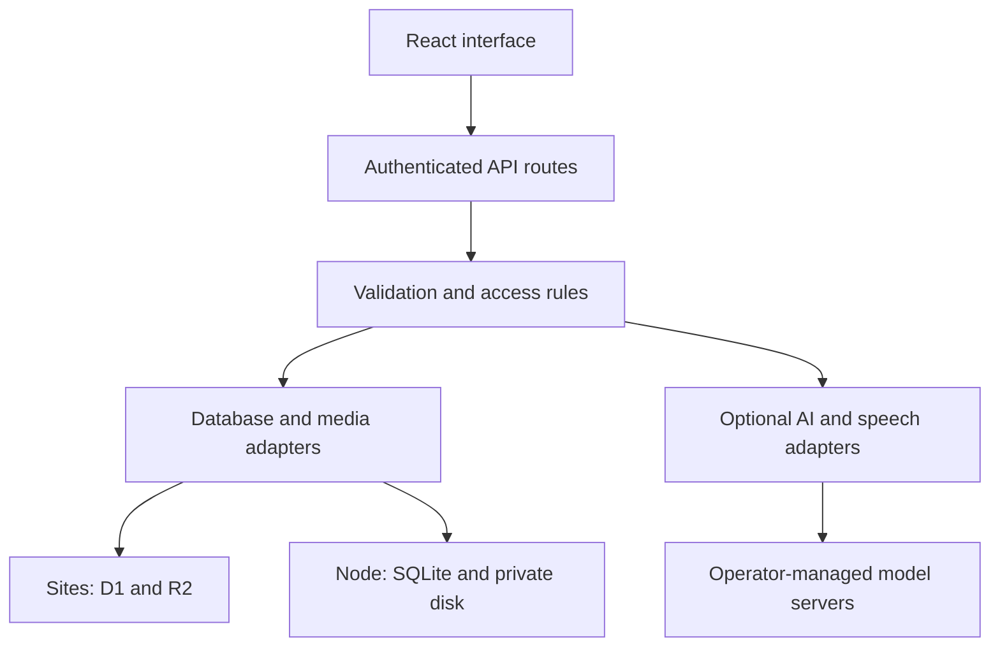

<div align="center">

# ŚATOR
### Wear your imagination.

**A full-stack fashion platform connecting discovery, garment design, community, and designer collaboration.**

[Explore the app](https://sator-fashion-studio.akshajaddandi.chatgpt.site) · [Architecture](docs/PRODUCT_ARCHITECTURE.md) · [Self-hosting](docs/SELF_HOSTING.md) · [AI integration](docs/AI_BACKEND.md)

**React · TypeScript · Next.js · SQLite · Drizzle · Tailwind CSS · Node.js**

</div>

---

## The idea

Fashion inspiration often lives in one app, customization in another, and conversations with designers somewhere else. ŚATOR brings those steps into one workspace: discover a style, create a garment concept, save or publish it, and collaborate with a designer to refine the result.

The product supports customers, independent creators, and emerging fashion businesses through distinct **Buy** and **Design** journeys.

**Founders:** Akshaj Reddy and Kamal.

> **Project status:** Functional application with a prepared self-hosted deployment target. The existing Sites deployment uses Cloudflare D1 and R2. The portable build uses Node.js, SQLite, and private disk storage. Render deployment and migration of existing production data are separate steps. AI model services, live payments, and manufacturing fulfillment are not activated by uploading this repository.

## Product capabilities

| Area | What the code implements |
| --- | --- |
| **Design studio** | T-shirt and hoodie customization with colors, text, graphic presets, front/back editing, uploaded artwork, positioning, rotation, undo/redo, and PNG preview export. |
| **Fashion discovery** | Search, category filters, creator portfolios, published designs, and inspiration collections. |
| **Creator community** | Posts, MP4 reels, follows, likes, comments, account activity, and persistent in-app notifications. |
| **Personal wardrobe** | Private clothing records, saved outfits, outfit planning, and photo inspiration pins. |
| **Designer collaboration** | Custom briefs, quotations, private conversations, milestone evidence, shared projects, feedback, and versioned design revisions. |
| **Startup workspace** | Product listings, inventory records, purchase requests, and order-status workflows. Payment and payout operations remain separately gated. |
| **Accounts and privacy** | Email/password accounts, recovery keys, revocable sessions, participant access checks, and private media delivery. |
| **Visual previews** | Manual camera/photo overlays, optional browser-side MediaPipe pose tracking, and a rotating garment concept viewer. These are visual previews, not fit guarantees or fabric simulations. |

## Engineering highlights

### Authorization belongs on the server

Authentication checks protect API routes independently of the interface. Drafts, wardrobe items, private photos, measurements, messages, and project records use owner or participant checks. The standalone runtime ignores hosting-specific identity headers rather than trusting identities supplied by a browser.

**Code:** [authentication](app/auth.ts), [email accounts](app/lib/email-auth.ts), [security helpers](app/lib/security.ts), [creative access rules](app/lib/creative-access.ts).

### Collaboration preserves revision history

Shared design projects use explicit versions. A save against an outdated version returns a conflict instead of silently overwriting a newer revision. Sharing is tied to an accepted designer quotation, and feedback and approvals are checked against project access and revision state.

**Code:** [creative workspace API](app/api/creative/route.ts), [workspace interface](app/components/CreativeWorkspace.tsx), [collaboration checks](tests/creative.mjs).

### Portability without discarding working data logic

The application supports two deployment targets. The hosted target uses Workers, D1, and R2; the standalone target adapts the existing SQLite-oriented queries and search to Node.js and private filesystem storage. This avoids presenting a storage-provider change as a completed data migration.

The portable runtime applies versioned migrations, checks historical migration integrity, exposes a storage health endpoint, and includes a backup utility. It is designed for one persistent-disk instance; horizontal scaling requires a different storage architecture.

**Code:** [Node runtime](runtime/node.mjs), [database schema](db/schema.ts), [migrations](drizzle), [backup utility](scripts/backup-node.mjs), [health endpoint](app/api/health/route.ts).

### AI integrations expose their real readiness

Server-side adapters support llama.cpp-compatible text/vision endpoints and a whisper.cpp-compatible transcription service. Voice input requires consent, uses a 30-second recording limit, and produces an editable transcript. Provider requests use configured endpoints, service credentials, and usage limits.

Models are not bundled or automatically started. Language accuracy, model licensing, hardware requirements, and real-device microphone behavior must be evaluated before advertising these integrations as live capabilities. Rule-based catalog guidance remains useful without a generative model.

**Code:** [intelligence API](app/api/intelligence/route.ts), [transcription API](app/api/transcribe/route.ts), [speech adapter](app/lib/speech-provider.ts), [AI documentation](docs/AI_BACKEND.md).

## Technology stack

| Layer | Technologies and responsibility |
| --- | --- |
| Interface | React 19, TypeScript, Tailwind CSS, Radix/Base UI primitives, Lucide icons |
| Application server | Next.js 16 for the standalone build; Vinext/Cloudflare integration for the Sites target |
| Validation and forms | Zod, React Hook Form |
| Records and search | SQLite / SQLite FTS5, Drizzle schema tooling, versioned SQL migrations |
| Hosted storage | Cloudflare D1 for records and R2 for uploaded media |
| Portable storage | Node.js SQLite and private files under `SATOR_DATA_DIR` |
| Authentication | scrypt password hashing, hashed session tokens, Secure/HttpOnly cookies, recovery keys |
| Visual tracking | MediaPipe pose tracking in the browser; manual alignment fallback |
| Optional AI and speech | Compatible self-hosted model endpoints; llama.cpp and whisper.cpp integration paths |
| Deployment | Node.js standalone output, Docker, Docker Compose, Render Blueprint |

Exact dependency versions are pinned in [package.json](package.json) and [pnpm-lock.yaml](pnpm-lock.yaml). Cloudflare and Render are managed services; using open-source application components does not make those hosting services open source. Model weights have their own licenses.

## Architecture



The deployment target selects the storage implementation. The diagram does not imply replication between the two databases. See [product architecture](docs/PRODUCT_ARCHITECTURE.md) for the user journeys, API behavior, and operating boundaries.

## Run the standalone application

Use **Node.js 24.19.0** and the pnpm version declared in `package.json`.

```bash
corepack enable
pnpm install --frozen-lockfile
pnpm run build:node
```

Set the runtime environment before starting the server. On a Linux/macOS shell:

```bash
export SATOR_DATA_DIR="$PWD/data"
export HOSTNAME=0.0.0.0
export PORT=3000
pnpm run start:node
```

On Windows PowerShell:

```powershell
$env:SATOR_DATA_DIR = Join-Path $PWD 'data'
$env:HOSTNAME = '0.0.0.0'
$env:PORT = '3000'
pnpm run start:node
```

`SATOR_DATA_DIR` must be a writable, private, persistent location. For normal deployment, put the app behind HTTPS: secure session cookies and microphone access depend on a secure context. The health endpoint is `/api/health`.

Use [deploy/self-hosted.env.example](deploy/self-hosted.env.example) as the non-secret configuration reference. Keep actual credentials in the server environment. Docker instructions, backup/restore, model-server configuration, and migration requirements are in [SELF_HOSTING.md](docs/SELF_HOSTING.md).

## Render deployment

The repository includes a [render.yaml](render.yaml) Blueprint for one Node web service with a persistent disk:

- Build: `corepack enable && pnpm install --frozen-lockfile && pnpm run build:node`
- Start: `node .next/standalone/server.js`
- Health check: `/api/health`
- Data: `/var/data/sator`, under a 10 GB disk mounted at `/var/data`
- Automatic code deployments: disabled in the prepared configuration

Connect the repository in Render and review the Blueprint before deploying. The configuration selects a **paid Starter service** and persistent disk; review the cost in your Render account. A free ephemeral filesystem will not preserve this version's SQLite database and uploaded files across restarts.

A first standalone launch initializes its own database. Existing D1/R2 data is **not** automatically imported. Keep the current deployment available until a migration and rollback plan have been tested.

## Verification

The source includes integration checks that exercise route logic against isolated SQLite fixtures. They cover authentication, ownership, discovery, messaging, notifications, creative collaboration, search, intelligence contracts, and standalone storage/speech boundaries.

```bash
pnpm exec tsc --noEmit
node tests/functional.mjs
node tests/auth-portals.mjs
node tests/email-auth.mjs
node tests/journey.mjs
node tests/community.mjs
node tests/search-experience.mjs
node tests/intelligence.mjs
node tests/creative.mjs
node tests/self-hosted.mjs
pnpm run build:node
```

The prepared release previously passed 149 automated checks, TypeScript, and the hosted and standalone production builds. This is a recorded local verification result, not a CI badge or evidence of successful Render deployment. Automated provider-contract tests do not establish live model quality, real-device behavior, accessibility compliance, or production load capacity.

## Repository guide

| Path | Purpose |
| --- | --- |
| [`app/components`](app/components) | Main product interfaces and workspaces |
| [`app/api`](app/api) | Server routes for accounts, content, collaboration, assets, and optional AI |
| [`app/lib`](app/lib) | Authentication, authorization, and provider helpers |
| [`db`](db) / [`drizzle`](drizzle) | Database schema, adapters, and migrations |
| [`runtime`](runtime) | Standalone storage/runtime implementation |
| [`tests`](tests) | Isolated backend integration checks |
| [`scripts`](scripts) | Build, execution, installation, and backup helpers |
| [`deploy`](deploy) | Non-secret self-hosting configuration reference |
| [`docs`](docs) | Product architecture, AI behavior, and deployment guidance |

## Current boundaries and next milestones

- **AI and voice:** provision licensed models, configure protected endpoints, and test representative English, Telugu, and Hindi samples.
- **Commerce:** validate payment-provider integration, seller onboarding, reconciliation, refunds, fulfillment, shipping, and tax handling before taking real orders or money.
- **Identity:** email/phone ownership verification and email/SMS delivery are not configured. Recovery currently uses a one-time recovery key.
- **Operations:** complete device/browser testing, accessibility review, abuse handling, backup restoration drills, and load testing.
- **Scaling:** measure usage and write concurrency before migrating to PostgreSQL and a separate object store. Local disks are not shared across replicas.

## Project credits

ŚATOR is a product initiative by **Akshaj Reddy and Kamal**, developed through iterative product direction and AI-assisted implementation. Technical claims in this README are linked to source files and validation scripts so reviewers can examine the work directly.

The editorial image in `public/images/sator-editorial.png` is generated illustrative artwork, not real product inventory. Third-party software and model assets retain their respective licenses. No public distribution license has been assigned to the application code in this repository.
