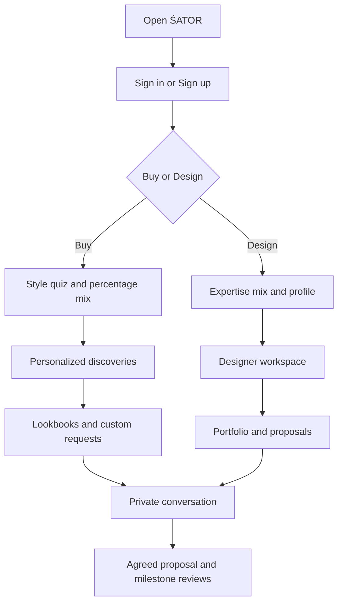

# ŚATOR: Buy / Design experience

## Entry and core journeys

The app opens with a short, skippable wordmark intro, then a branded, mandatory sign-in screen. There is no guest entry, catalog bypass, or portal selection before authentication. An existing valid session counts as authenticated; the app does not force password re-entry on every visit. The default account flow uses email/password with an optional phone number at signup. Existing ChatGPT sign-in remains a secondary option; Google and Apple are not configured. Private APIs and uploaded media independently check server identity.

The opening shows the ŚATOR name without a separate logo emblem, with “Wear your imagination” below it on black. An expanding ivory circle transitions to sign-in or, for an existing authenticated session, the two portals. The approximately 3.35-second intro supports Skip, Escape, reduced motion, sound mute and replay. One classic bell plays at completion when browser audio is permitted; Enter with sound unlocks it with a tap, and the header offers Play bell if autoplay was blocked. Returning from sign-in skips the duplicate intro. Authentication and all private API checks remain independent of this presentation layer.

### Buy

1. Select Buy after signing in.
2. Choose one or more aesthetics: Old Money, Baggy / Streetwear, Formals, Casuals, Vintage, Custom Tailoring, Minimal, Experimental.
3. Adjust relative preference sliders. The preview normalizes the selected weights to exactly 100%, including rounding. A 70 / 30 mix is stored as such.
4. Complete name, city and optional personal bio.
5. Enter For you: a style summary, matching designer shortlist and ranked pieces.
6. Inspect a design or product, check fabric details, customize it, message the designer, pin it to a lookbook, or open available purchase options.
7. Optionally save measurements, request an entire look, or publish a custom brief with a budget and deadline.

### Design

1. Select Design after signing in.
2. Choose strongest niches and their relative emphasis.
3. Add display name, city, design story and optional portfolio URL. Enable ready-made selling and provide a label name when applicable.
4. Enter the designer dashboard. Create designs/posts, add piece-specific fabric and style metadata, inspect matching request briefs, and send private proposals.
5. Discuss changes with buyers, build non-binding limited-run interest campaigns, and submit production evidence on accepted commissions.

Design expertise is self-declared. Portfolio niche assessment is an explainable combination of declared specializations, tagged portfolio pieces and published design counts. It is not an automated assessment of professional skill or a verification badge.

## Information architecture

| Area | Buyer navigation | Designer navigation |
| --- | --- | --- |
| Discovery | For you, Explore, Community, Reels, ready-made collections | Explore, Community, ready-made collections |
| Personal style | Style mix, lookbooks, measurement vault | Expertise mix, lookbooks, measurement vault |
| Making | Design studio, camera/photo preview | Design studio, 360° preview, fabric & portfolio details |
| Collaboration | Request board, private messages, milestone reviews | Request board, proposals, private messages, milestone reviews |
| Commerce | Orders and payments, limited-run interest | Creator dashboard, optional startup dashboard, product inventory, limited-run campaigns |
| Account | Profile, support inquiries, sign out, switch to Design | Profile, support inquiries, sign out, switch to Buy |

## Discovery logic

- Buyer preference weights are private, server-persisted records.
- Designer public specializations come from saved Design onboarding.
- Explicit style tags on a piece take priority. Otherwise, the piece inherits its designer's positive niche tags. Studio concepts fall back to labeled design categories.
- A piece's score is the sum of the buyer's weights for its distinct matching tags. For example, an Old Money piece scores 70 for a 70% Old Money / 30% Streetwear buyer.
- Match score determines ordering. Real community pieces precede samples when scores tie; recency breaks remaining ties.
- The designer shortlist shows creators with overlapping styles. It ranks style relevance, not quality, revenue, credentials or popularity.
- New and unmatched pieces remain discoverable. Empty states explain when the real community has not yet populated a niche.
- UI labels explain shared styles rather than presenting a probability of fit or quality.

## Connected feature matrix

| Feature | Current implementation | Remaining dependency or limit |
| --- | --- | --- |
| Account access | Email/password signup and sign-in, optional private phone, recovery keys, optional existing ChatGPT access, protected API/media checks | Email/phone ownership verification and email/SMS recovery are not connected; browser flows need verification |
| Style quiz | Selectable aesthetics, normalized percentage sliders, durable preferences | Recommendations use explicit matching, not an ML model |
| Creator discovery | Profile niches, per-piece tags and published design counts | No independent expertise certification |
| Measurement vault | Private cm storage, cm/in display, validation, deletion and explicit sharing through a chat draft | No promise of perfect fit; designer must confirm sizing and alterations |
| Moodboards / lookbooks | Named collections, pin/remove pieces, one brief to request the whole look | One-click paid multi-seller checkout is not implemented |
| Request board | Budgets, dates and style tags, designer quotes, optional private sketches, proposal selection | No manufacturing order or payment is created automatically |
| Direct messaging | Private buyer/designer threads, product-specific change requests, persistence and 15-second refresh | Polling rather than sockets; no email or push notifications |
| Fabric & technical details | Composition, GSM, stitching, care, images/MP4 and certificate evidence linked to portfolio pieces | Designer-supplied claims; no automated material verification or full production tech-pack export |
| Camera / photo preview | On-device 2D garment overlay, manually adjustable; optional camera pose tracking | Not photorealistic AR, drape simulation or sizing measurement |
| 360° preview | WebGL extruded garment silhouette with front/back artwork, drag and slider rotation | Concept geometry, not a production garment model |
| Limited-run drops | Targets, deadlines, indicative pricing, idempotent interest registration and withdrawal | Non-binding interest only; paid pre-order deposits are not connected |
| Milestone reviews | Accepted commission, materials-before-dispatch evidence, buyer approval/change requests | Review is not a payment release or independent quality certification |
| Escrow payments | Clearly labeled funding unavailable; proposed 50% / 50% milestones shown | Needs a provider supporting the intended funds-holding/release flow, ledger, reconciliation, refunds and disputes |
| AI/admin verification | Not activated or represented as verified | Requires an actual service and assigned reviewers; images alone cannot establish material composition or durability |

## Core MVP value statements

| Feature | Buyer value | Designer value |
| --- | --- | --- |
| Measurement vault | Reusable measurements and clearer sizing conversations | Better briefs and fewer avoidable misunderstandings |
| Custom requests | A way to ask for an outfit that does not yet exist | A stream of style-relevant briefs and potential customers |
| Milestone evidence | Visibility into progress and a record of review | Explicit feedback before moving to the next stage |
| Future escrow | Could reduce payment risk under agreed provider terms | Could support clearer, verified release milestones |

The platform must not promise zero fraud, guaranteed payment or perfect fit. These outcomes depend on contracts, actual payment operations, accurate measurements and fulfillment.

## Data and permission architecture

Authentication establishes a stable site-specific user ID. The server ignores any claimed owner ID supplied by the browser.

| Record | Read access | Write access |
| --- | --- | --- |
| Buy style profile | Account owner | Account owner |
| Design profile / published niches | Signed-in members | Account owner |
| Measurement vault | Account owner | Account owner; deletion supported |
| Lookbook | Account owner | Account owner |
| Open request | Signed-in members | Buyer who posted it |
| Proposal / sketch | Proposing designer and request owner | Onboarded designer; one quote per request |
| Private messages | Conversation participants | Conversation participants |
| Published fabric metadata | Signed-in members | Owner of the portfolio piece |
| Draft fabric metadata | Owner only | Owner only |
| Interest campaign | Signed-in members | Owner of a published portfolio piece |
| Interest registration | Aggregate count and own participation | Signed-in member; creator cannot pledge to their own drop |
| Commission / evidence | Buyer and selected designer | Designer uploads; buyer reviews |

D1 stores structured records and R2 stores uploaded media. Uploaded production evidence and proposal sketches have participant-specific access checks. Private responses and media use no-store caching. The source repository contains no user measurement records, credentials or chat content.

Important tables: `style_profiles`, `measurement_vault`, `lookbooks`, `design_requests`, `design_bids`, `conversations`, `chat_messages`, `item_specs`, `preorder_drops`, `drop_pledges`, `commissions`, `quality_evidence`. Existing catalog, profiles, designs, purchases, inventory and social tables remain in place.

## States and error handling

- Authentication: intro, welcome, sign-up form, email sign-in form, optional provider return, recovery-key reset, authenticated, expired, retryable failure.
- Onboarding: no styles selected, style mix in progress, profile fields required, saving, saved, retryable error.
- Feed: populated, no matching designers yet, no search matches, refresh failure.
- Requests: open, closed, matched; duplicate proposals and conflicting acceptance are rejected.
- Chat: no conversation, empty conversation, draft, sending, sent, permission denied. Measurement sharing adds selected values to the draft; it never sends them automatically.
- Drops: gathering interest, target reached, deadline passed. Target completion does not create a payment or production run.
- Milestones: waiting for evidence, submitted, approved, changes requested. Dispatch evidence requires the latest materials evidence to be approved.

## Future payment architecture

An actual escrow rollout must be implemented as a separate verified funds flow. The present UI must stay unfunded until that integration is complete.

1. Agree the quote, specifications, cancellation/return terms and release milestones.
2. Create a provider-backed funding transaction with an idempotency key and server-owned amount.
3. Confirm funding through signed provider events and reconcile the ledger.
4. Record material evidence and authorized review.
5. Request the first release through the provider, then wait for its confirmed event.
6. Repeat for dispatch under the agreed terms.
7. Handle changes, failures, disputes, refunds and settlement reconciliation explicitly.

The existing checkout adapter is not described as escrow. The review endpoint does not call it, alter purchase payment status, or initiate transfers.

## Verification

The update has 40 integration scenarios across the existing store, portal authentication and Buy/Design suites. These exercise real route logic, migrations and SQLite with isolated identity and media fixtures. Coverage includes persistence, anonymous rejection, cross-account privacy, proposal isolation, private media, unique interest registrations, milestone sequencing and no unintended payment state changes. TypeScript and production-build checks are run before publication.

Browser-control capability is unavailable in this environment. Responsive visual behavior, the hosted authentication round trip, WebGL rendering, camera permissions, audio, and physical device behavior remain to be tested in a browser. Test success is not a claim of a complete commercial-launch audit.

## Community reliability update — 19 October 2026

### Discovery across accounts

- `/api/discovery` queries shared published designs, image/video posts and ready-made listings directly in SQLite. Search happens before pagination, so a creator or an older piece does not disappear because it is outside the newest 100 feed entries.
- Explore includes a public people directory. Creator and Startup portal registrations from the earlier onboarding flow remain discoverable even without a Design style profile. Startup brand names and owner display names can both be searched.
- Public profile links use `?profile=<user-id>#profile` and show published work, bio, declared roles, counts and public style information. Email, purchase contact details, measurements, private conversations and drafts are excluded.
- Published media access is checked server-side. Share links to older posts load the requested post into Community.
- Main feed and workspace data refresh every 10 seconds while visible and on focus. Discovery independently refreshes every 10 seconds. Session changes clear private state. Errors show stale-data status rather than pretending synchronization succeeded.

### Messaging

- Customers can initiate private conversations from creator and startup profiles or published product/design pages. The existing participant identity model is preserved.
- `/api/chat` supplies inbox previews and unread counts, participant-authorized history with cursor pagination, idempotent client message IDs, stored read receipts, and account blocking. Legacy message routes also enforce blocks.
- An active chat polls every 3 seconds; the navigation inbox badge polls every 5 seconds. These are near-live updates using HTTP polling, not WebSocket push. No email or device push notifications are configured.
- Drafts survive failed sends; retrying identical content uses its original message ID. Read receipts acknowledge an actual message loaded in a visible thread. Selected measurement sharing remains an explicit draft action.
- Message history pages use both timestamp and message ID to avoid losing messages with equal timestamps. Inbox displays the 200 most recently updated conversations; unread totals include the full inbox. Larger inbox pagination remains future work.

### Analytics

- `/api/activity` returns metrics only for the signed-in account: views, likes, comments, saves, shares, followers, drop registrations and verified payment totals.
- View collection is limited to published content or public profiles; self-views are excluded. Repeated views are deduplicated per signed-in viewer, item and UTC day. A new view series begins on this release; no historical views are fabricated.
- The seven-day chart combines daily content and profile views. Content rows show exact persisted reaction totals rather than counts from a truncated feed.
- Net collections count live paid/refunded payment records minus recorded refunds. Test payments and unpaid requests never count as revenue. Non-refunded unit counts exclude orders with any recorded refund because item-level refund quantities are not modeled.

### Shopping and support companion

- A floating companion searches the real published catalog with keyword and maximum-budget matching, explains supported workflows, and saves private retry-safe support requests.
- Without provider credentials it labels itself a Shopping & support guide. It does not claim generative intelligence or a staffed service.
- A server-only OpenAI Responses API adapter is implemented. Activation requires approved `OPENAI_API_KEY` and `OPENAI_MODEL` runtime settings. Neither is configured at this release. Provider calls require the visitor to opt into AI replies; only the entered assistant chat and public catalog context are sent, with `store: false`. Measurements, orders and private member messages are excluded.
- The adapter uses no tools that can spend money, change an account, contact a third party or alter an order. Provider errors fall back to the catalog guide with an explicit label.
- Support requests are saved with status `recorded`; a staffed support queue, notifications and response-time commitments are not connected.
- Provider reference: https://developers.openai.com/api/reference/resources/responses/methods/create

### Storage and checks

Existing D1 (SQLite) and R2 remain the production stores. Chat is implemented in the application source with SQLite persistence; it requires no third-party hosted chat subscription. D1 is managed hosting, not a self-hosted open-source service.

The migration adds conversation read state, member blocks, deduplicated content views and support tickets without modifying or deleting existing data. Cross-account integration tests use actual route implementations, all migrations and isolated SQLite identities. Hosted sign-in redirects, browser rendering, camera/audio and multiple live devices still require browser/device verification.

## Community portfolios and notification inbox

- Community → creator name/avatar → public portfolio → Connect / Message → private conversation. Opening Connect does not send message text or imply a mutual follow. Existing conversations are reused; blocking remains enforced.
- A notification bell sits alongside the cart and Create controls. Its account-scoped inbox updates every five seconds while visible, with All/Unread, pagination, read-one and mark-all-through-the-last-seen-event controls. Session changes remount and clear the inbox.
- Events originate in the same database transaction as actual likes, comments, follows, conversation starts/messages, proposals, accepted proposals and production evidence/reviews. No random actors, fabricated likes, historic backfills or invented completion updates are displayed.
- Each alert resolves the relevant published content, member portfolio (if public), authorized conversation, custom request or production review. Unpublished/deleted work and blocked actors are filtered out of both lists and unread counts. Message bodies and other private details are not included in previews.
- Alert read state is distinct from message read receipts. A message alert may be acknowledged independently; opening and acknowledging the underlying chat also clears corresponding message alerts. Finished-garment alerts explicitly request buyer review.
- In-app notification persistence is implemented. Device/browser push and offline notification delivery remain unconnected. Live browser/device verification remains outstanding.

## Email access and account boundaries

Welcome → Sign up (name, email, password, optional phone) or Sign in (email and password) → Buy / Design. Existing members who used ChatGPT can choose that provider from Sign in. No guest identity is fabricated and accounts are never linked from matching email text.

`POST /api/auth` creates durable email accounts and server sessions, signs in, resets a password using a one-time recovery key, and revokes sessions on logout. All private endpoints call the unified `getAppUser` resolver. A present but invalid email cookie fails closed rather than falling through to a different provider identity. Password reset revokes old sessions through account-version checks as well as deleting existing tokens.

Names can appear with a profile. Email and phone remain private contact data and are not verified ownership assertions. Phone signup is optional and is not a phone-number login or OTP flow. Recovery keys are shown once and stored as digests; no email or SMS reset is claimed. Native scrypt, random opaque sessions, secure cookies, same-origin JSON and durable throttles protect the account flow. Authentication tests use isolated fixtures, never production customer records.

## Member profiles and launch audit — 19 October 2026

- Community author names, avatars, comments and search results open individual member profiles. Profiles include an owned photo, bio, follower/following counts and separate All work, Posts, Reels, Designs and Products views. Owners can publish a post/reel or edit their profile from that page. Other members can connect, message, follow, share a link or block messaging and new social interactions.
- Search includes registered buyers, designers and startups, supports empty results and database pagination, and excludes unpublished content and private contact data. Search visibility can be disabled without hiding public posts or direct profile links.
- Public sales use only units from live, paid, non-refunded purchases. Owners may hide this count. Payment setup and paid checkout capabilities have not changed.
- Saved collections are reachable from the sidebar. The account-scoped activity API resolves saved and liked content independently of feed limits, includes studio samples, supports collection names and moving bookmarks, and exposes only the signed-in member's activity.
- Settings & activity contains Edit profile, Your activity, Notifications, Privacy & connections, Shopping & style, and Account & access. These sections use actual routes and persisted values. Notification categories filter both the bell and its unread count; messages remain in the chat inbox when their bell category is disabled.
- Comments load and paginate by piece, refresh every five seconds while active, link to member profiles, and support author-only deletion. A client-generated comment ID protects retries. Existing database triggers generate and remove recipient notifications in the same transaction as the comment.
- Blocking stops new private messages, likes, comments and follows between the two members, and hides related alerts. It does not hide already-public profiles or earlier public discussions. Settings lists the account's blocks and supports unblocking.
- Publishing a private third-party upload by guessing its asset path is rejected; already-published artwork remains usable for remixes. Discussion bodies for unpublished designs no longer appear in shared store responses.

Validation: 11 store scenarios, 14 authentication/portal scenarios, 15 Buy/Design scenarios, 12 email-authentication scenarios and 43 cross-account community scenarios pass against real application routes and all SQLite migrations, using isolated identity and storage adapters. TypeScript and production build are separate release gates. Browser/device rendering, the live hosted sign-in journey, video playback and audio need device verification. Updates use polling (comments/alerts 5 seconds, feed/profiles/activity 10 seconds, chat 3 seconds), not WebSocket push. Generative AI, payments, staffed support and device push retain their previously documented integration status. This audit does not certify every unrelated feature or a production load limit.

## Wardrobe, inspiration and design projects — 19 October 2026

- **My wardrobe** stores up to 300 owned garments with private photos, category, color, occasion tags, season and notes. Editing and deletion use the signed-in account, never a browser-supplied owner. Photos remain protected by the existing authenticated asset route.
- **Outfit planner** builds combinations from those saved garments. It uses category, season, occasion tags and neutral colors; this is an explainable rule-based feature, not generative AI. Members can adjust a suggestion or manually select up to 12 garments, then save up to 100 named outfits. A removed wardrobe piece is shown as missing in existing outfits rather than silently replaced.
- **My lookbooks** now accepts private uploaded reference photos and written inspiration notes alongside the existing published-piece pins. Removing a lookbook removes its private pins through a migration-owned cleanup trigger. A pin can seed a new design project with its photo and note.
- **Design projects** can start from the current studio canvas, a saved design, an inspiration pin, or a written AI brief. New projects are private by default. Sharing requires selecting an already accepted quotation; the server derives the counterpart and buyer reviewer from that commission. It never trusts an arbitrary collaborator ID from the browser.
- Each project retains the first concept and up to 100 numbered design revisions with author, time and change note. Optimistic version checks reject stale saves. Retried revisions have stable IDs. New revisions reset concept approval, and only the buyer can approve a shared concept or request changes. Feedback and reviews are stored in a project activity history. Projects poll every 10 seconds while visible. They do not send email or device push alerts.
- Participants can read shared reference photos and prior revision artwork. Other accounts cannot. Account blocking removes shared access in either direction. Owner archival makes a project read-only while preserving its history. Concept approval never places an order, releases money or updates production evidence.
- **AI & try-on** includes a photo-and-voice concept composer. Browser speech recognition provides an editable transcript in the chosen language, subject to browser language support. The user can always save a written brief and uploaded reference as a private project. AI generation uses the existing server-side provider adapter with explicit per-request consent, owned images, rate limits, structured output and validation. Output is an editable T-shirt / hoodie 2D configuration, not a generated photorealistic image or a manufacturing pattern. Unsupported garment shapes and construction changes stay in the designer brief.
- Live AI remains **unconfigured**. The user approved creating a new API key and the ignored `.env.local` destination, but the required secure key helper was unavailable in this execution environment. No key was created or written, no runtime secret was changed, and no live provider request was made. OpenAI Developers is installed; the remaining block is secure provisioning availability, not plugin installation. Provider tests use dummy credentials and mocked responses only.

New tables: `wardrobe_items`, `wardrobe_outfits`, `inspiration_pins`, `design_projects`, `project_revisions`, `project_events`. New APIs: `/api/creative` and `/api/concepts`. All new routes require account identity and use private/no-store responses.

Verification adds 18 integration scenarios for persisted wardrobe/outfits, cross-account photo and project isolation, accepted-commission sharing, concurrent/stale revisions, buyer-only reviews, blocking, archive behavior, and provider failure/consent handling. Existing suites remain release gates. TypeScript and a production build are checked separately. No browser automation capability is available in this environment; visual layout, physical microphone/camera behavior and live multi-device use remain unverified.

Implementation reference: https://developers.openai.com/api/docs/guides/structured-outputs
